**# UNIVERSIDAD DE SAN CARLOS DE GUATEMALA**

**# FACULTAD DE INGENIERÍA**

**# ESCUELA DE CIENCIAS Y SISTEMAS**


**# Informe Técnico: Respaldo y Restauración de Bases de Datos**


**\*\*Curso:\*\*** Sistemas de Bases de Datos 2 - Segundo Semestre 2026  

**\*\*Estudiantes:\*\***&#x20;

\- Norma Elizabeth Canú Xico - 202300768- *\*Craga 1 (por anio)\**

\- Brayan Emanuel Garcia -  202300848 - *\*Carga 2 (Por Deporte/Evento)\**

\- Valery Nicolle Galvez Garcia — 202200141 - *\*Carga 3 (Por Deportista: Michael Phelps)\**


\---


**## Índice**

1\. [Descripción de la Metodología]\(#1-descripción-de-la-metodología)

2\. [Especificaciones Técnicas del Servidor]\(#2-especificaciones-técnicas-del-servidor)

3\. [Modelo Entidad-Relación]\(#3-modelo-entidad-relación)

4\. [Plan de Respaldo]\(#4-plan-de-respaldo)

5\. [Ejecución de Cargas y Respaldos Físicos]\(#5-ejecución-de-cargas-y-respaldos-físicos)

6\. [Análisis Comparativo de Resultados]\(#6-análisis-comparativo-de-resultados)

7\. [Conclusiones]\(#7-conclusiones)

8\. [Manual de Usuario]\(#8-manual-de-usuario)


\---


**## 1. Descripción de la Metodología**

El presente proyecto implementa una estrategia integral de copias de seguridad y recuperación (Disaster Recovery) para una base de datos relacional PostgreSQL contenerizada mediante Docker. Se abandonó el uso de herramientas de volcado lógico (dumps) en favor de respaldos físicos a nivel de sistema de archivos, garantizando la recuperación en un punto en el tiempo (PITR) y la consistencia transaccional. La metodología se divide en tres fases de carga diferenciadas para validar el comportamiento del motor ante el crecimiento transaccional.


**## 2. Especificaciones Técnicas del Servidor**

\- **\*\*Sistema Operativo (Host):\*\*** Ubuntu Linux

\- **\*\*Motor de Base de Datos:\*\*** PostgreSQL 17 (Imagen \`postgres:17-alpine\`)

\- **\*\*Contenerización:\*\*** Docker Compose con volúmenes persistentes (\`./pgdata\` y \`./backups\`)

\- **\*\*Configuración del Motor:\*\***

  - \`archive_mode = on\` (Habilitado para permitir respaldos incrementales)

  - \`wal_level = replica\`

  - \`summarize_wal = on\`


**## 3. Modelo Entidad-Relación**

![Modelo]\(images/ModeloFinal.png)


**## 4. Plan de Respaldo**

La política de continuity operativa establece la ejecución de un **\*\*Full Backup\*\*** (Copia de Seguridad Completa) tras la estabilización de los catálogos iniciales. Posteriormente, se capturan las modificaciones transaccionales mediante **\*\*Backups Incrementales\*\*** físicos leyendo los manifiestos de respaldo (\`backup_manifest\`). Todos los archivos se almacenan físicamente en el volumen mapeado localmente en el directorio \`/backups\`.


\---


**## 5. Ejecución de Cargas y Respaldos Físicos**


**### 5.1 Carga 1: Por Año (Norma Canú Xico - 202300768)**

Se realizaron tres fases de carga insertando la información histórica de forma progresiva.


**\*\*A. Carga Inicial (Histórico hasta 2012)\*\***

\- **\*\*Comando de respaldo ejecutado:\*\***

  \`\`\`bash

  pg_basebackup -U postgres -D /backups/00_completo -Fp -Xs -v -P

  \`\`\`

\- **\*\*Evidencias de Carga y Backup:\*\***

  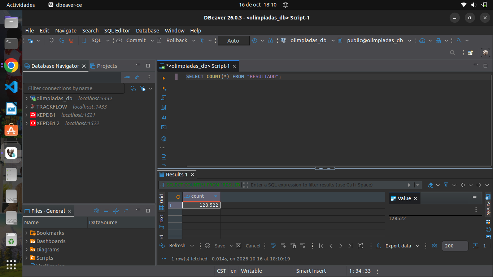

  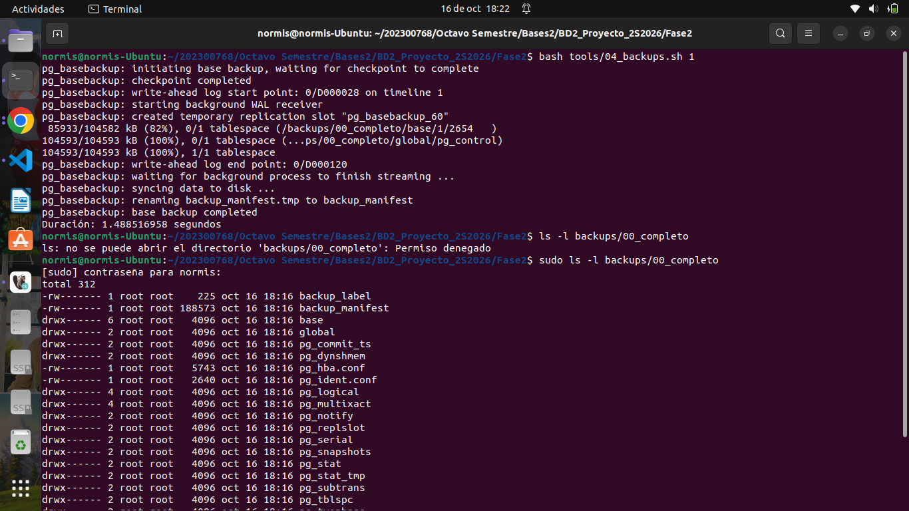


**\*\*B. Primera Carga Incremental (Año 2016)\*\***

\- **\*\*Comando de respaldo diferencial ejecutado:\*\***

  \`\`\`bash

  pg_basebackup -U postgres -D /backups/01_incremental --incremental=/backups/00_completo/backup_manifest -Fp -Xs -v -P

  \`\`\`

\- **\*\*Evidencias de Carga y Backup:\*\***

  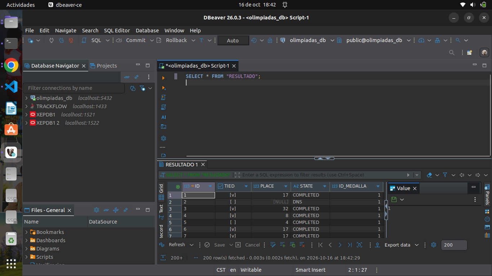

  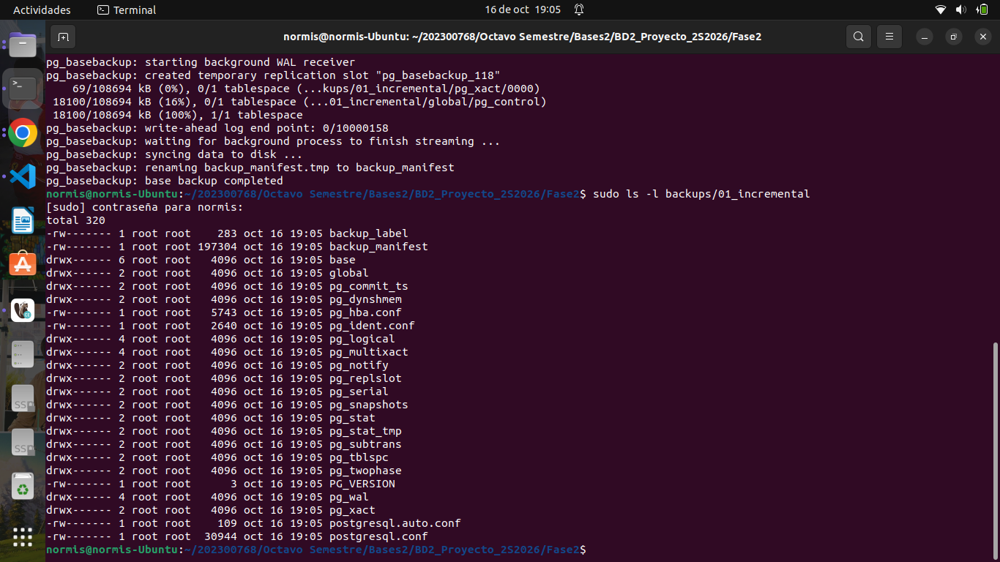


**\*\*C. Segunda Carga Incremental (Año 2020)\*\***

\- **\*\*Comando de respaldo diferencial encadenado:\*\***

  \`\`\`bash

  pg_basebackup -U postgres -D /backups/02_incremental --incremental=/backups/01_incremental/backup_manifest -Fp -Xs -v -P

  \`\`\`

\- **\*\*Evidencias de Carga y Backup:\*\***

  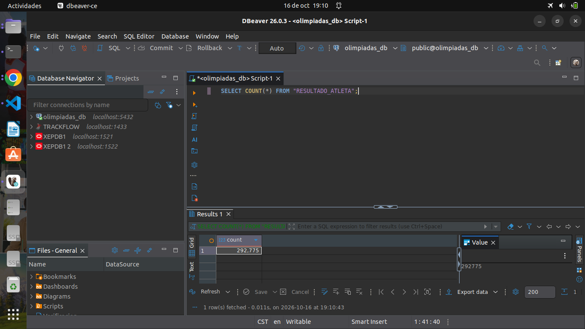

  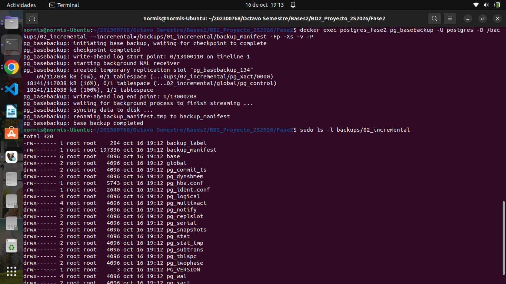


**\*\*D. Pruebas de Restauración y Validación de Integridad\*\***

\- **\*\*Restauración Full Backup (0.86s):\*\***

  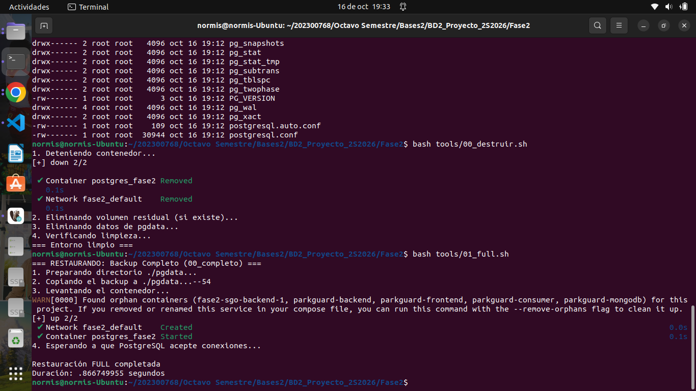

  *\*Comprobación de datos restaurados:\**

  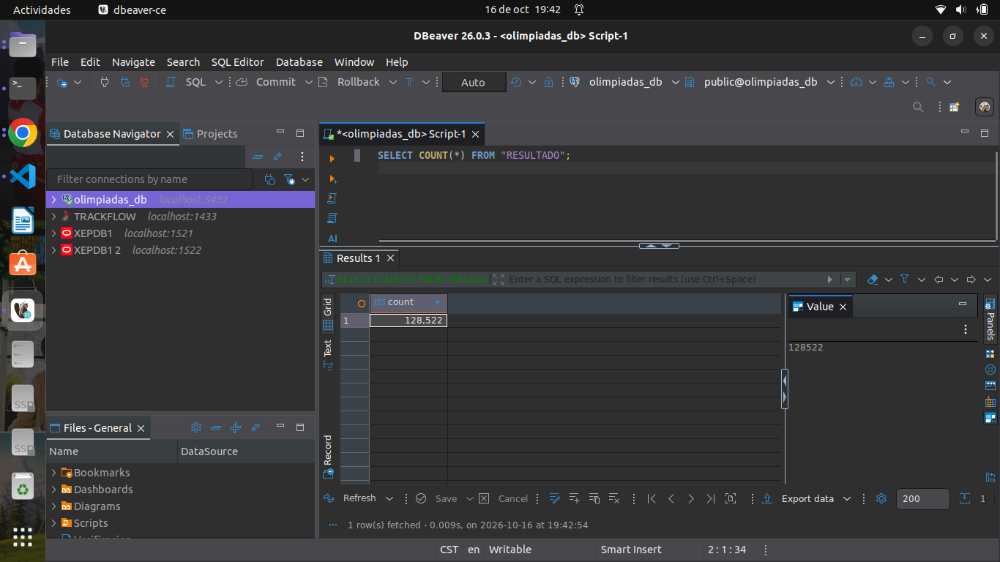

  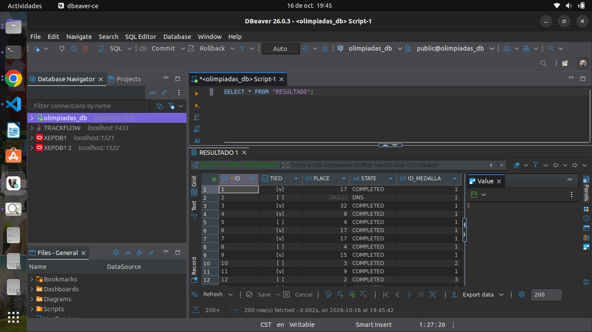

  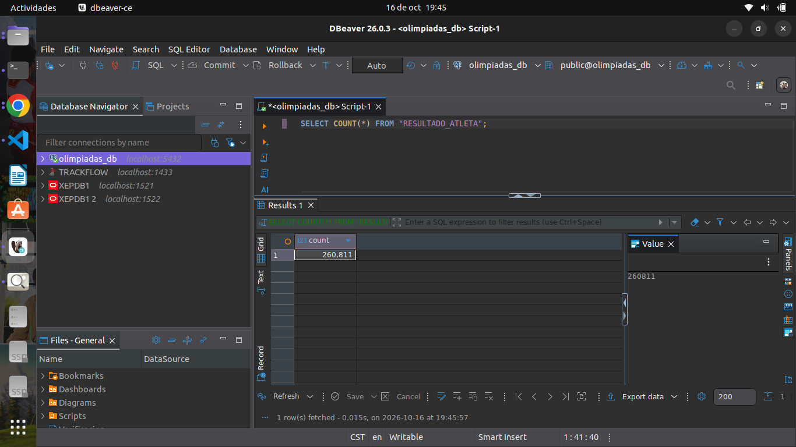

  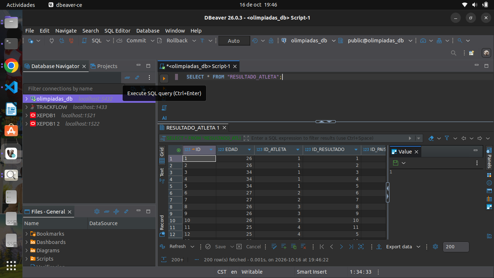


\- **\*\*Restauración Full + Incrementales (3.73s):\*\***

  ![Tiempo Restauración Incrementales]\(images/Restauración%20FULL_INCREMENTALES.png)

  *\*Comprobación de datos restaurados:\**

  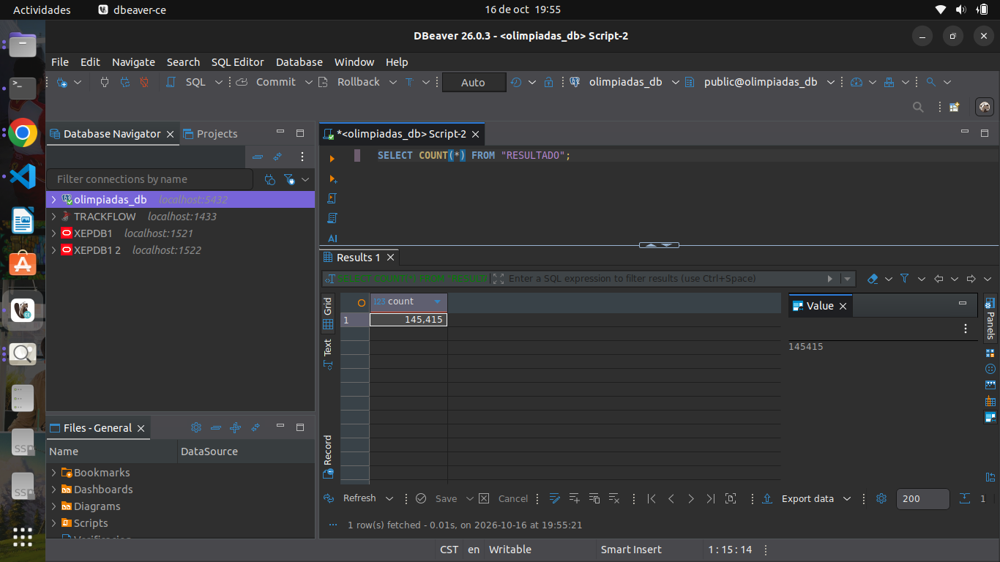

  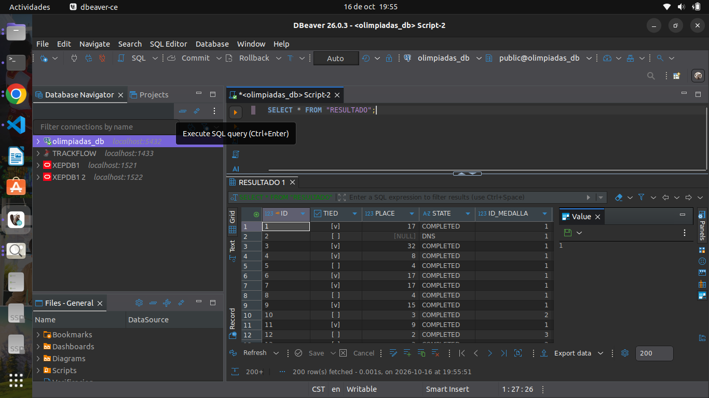

  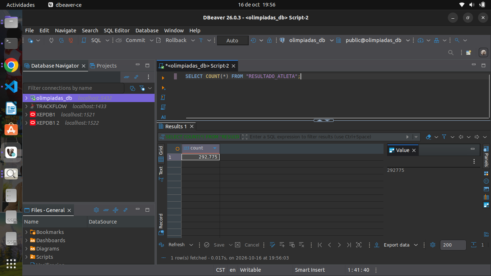

  


**### 5.2 Carga 2: Por Deporte / Evento (Brayan Emanuel Garcia)**


**\*\*A. Primera Carga, resultados de arqueria\*\***

\`\`\`sql

\copy "RESULTADO" FROM '/cargas/12_RESULTADO_archery.csv' WITH (FORMAT csv, HEADER true);

\copy "RESULTADO_ATLETA" FROM '/cargas/13_RESULTADO_ATLETA_archery.csv' WITH (FORMAT csv, HEADER true);

\`\`\`

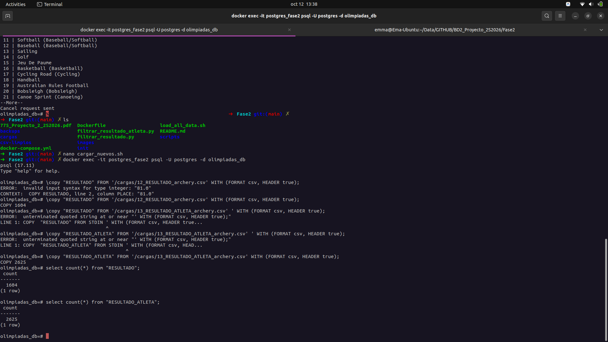

\- **\*\*Primer Backup con informacion de arqueria\*\***

\`\`\`bash

cp tools/04_backups.sh

chmod +x 04_backups.sh

./backups.sh 1

\`\`\`

**\*\*B. Segunda Carga, resultado golf\*\***

\`\`\`sql

\copy "RESULTADO" FROM '/cargas/12_RESULTADO_golf.csv' WITH (FORMAT csv, HEADER true);

\copy "RESULTADO_ATLETA" FROM '/cargas/13_RESULTADO_ATLETA_golf.csv' WITH (FORMAT csv, HEADER true);


\`\`\`

\- **\*\*Segundo Backup con informacion de golf\*\***

\`\`\`bash

cp tools/04_backups.sh

chmod +x 04_backups.sh

./backups.sh 2

\`\`\`


**\*\*C. Tercera Carga, resultado handball\*\***

\`\`\`sql

\copy "RESULTADO" FROM '/cargas/12_RESULTADO_golf.csv' WITH (FORMAT csv, HEADER true);

\copy "RESULTADO_ATLETA" FROM '/cargas/13_RESULTADO_ATLETA_golf.csv' WITH (FORMAT csv, HEADER true);


\`\`\`

\- **\*\*Segundo Backup con informacion de golf\*\***

\`\`\`bash

cp tools/04_backups.sh

chmod +x 04_backups.sh&#x20;

./backups.sh 3

\`\`\`


**#### Evidencia de tiempo por cada backup hecho:**


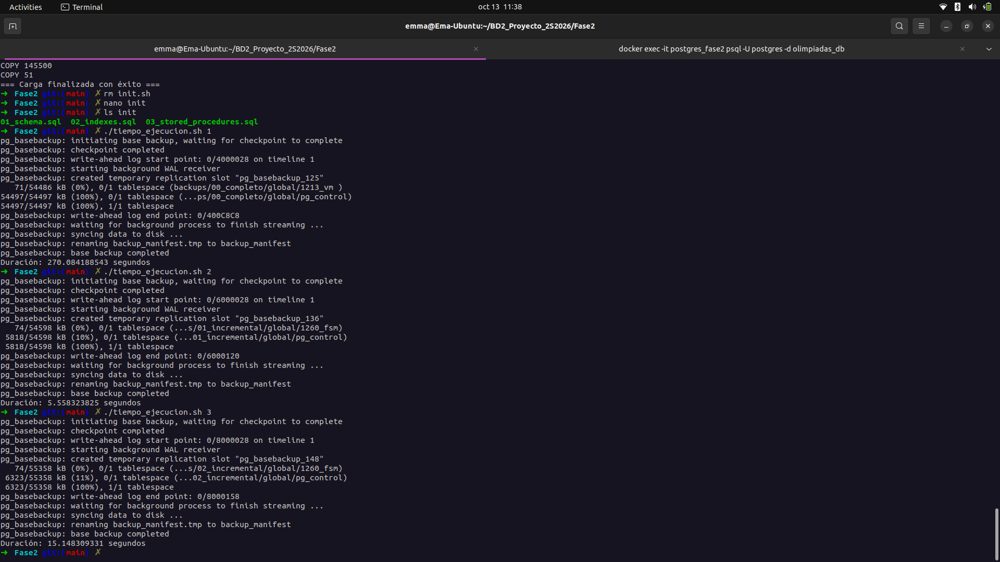


**### 5.3 Carga 3: Por Deportista (Michael Phelps — Carné 202200141)**

La tercera estrategia de carga se desarrolló tomando como referencia los resultados olímpicos de **Michael Phelps**. Se insertaron progresivamente los registros de `RESULTADO` y `RESULTADO_ATLETA`, separándolos por edición olímpica. Se utilizó PostgreSQL 17 sobre Docker y un esquema de **un respaldo físico completo (FULL) más tres incrementales**.

> Los respaldos físicos se generan sobre el clúster completo de PostgreSQL; Michael Phelps es el deportista seleccionado para organizar las cargas y comprobar los resultados restaurados.

**A. Preparación y carga inicial: Sídney 2000 y Atenas 2004**

Se prepararon CSV separados por año para ambas tablas con el script `scripts/filtrar_deportistas.py`. La carga inicial comprendió las ediciones de 2000 y 2004. Tras esta etapa, el estado validado fue de **9 resultados y 9 participaciones**, y se ejecutó el respaldo FULL.

```powershell
docker exec postgres_fase2 pg_basebackup -U postgres -D /backups/carga3_phelps/00_completo -Fp -Xs -v -P
```

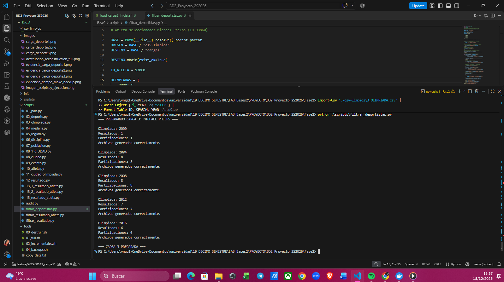

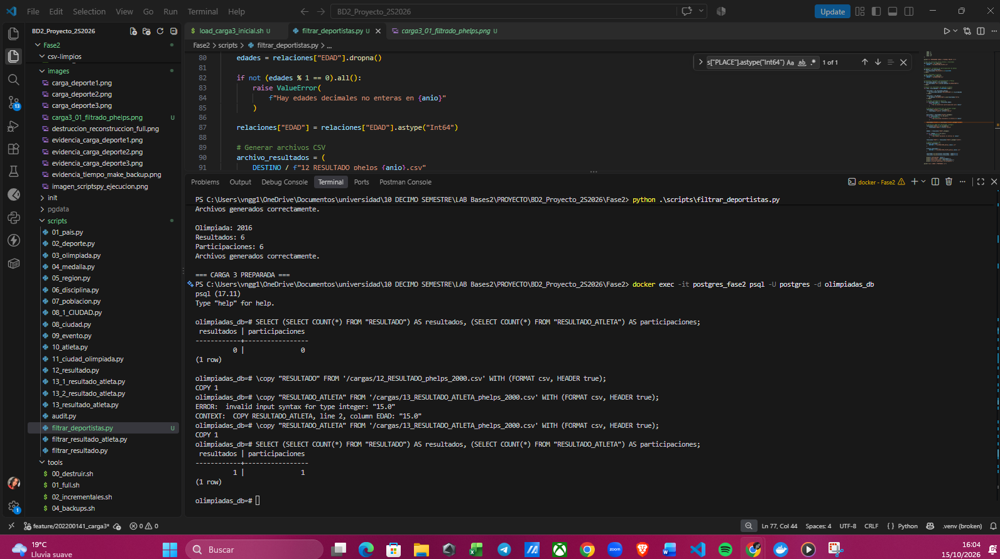

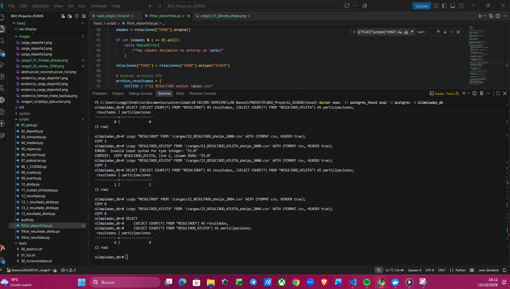

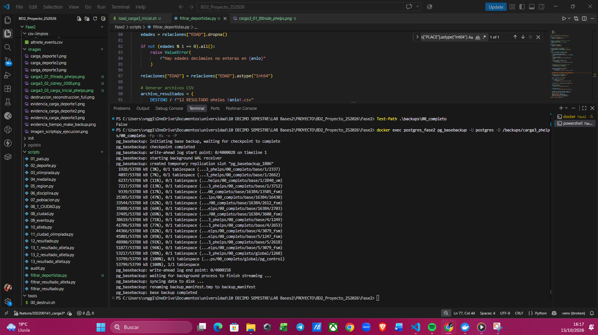

**B. Primera carga incremental: Pekín 2008**

Tras incorporar los resultados correspondientes a 2008, se generó el primer incremental tomando como referencia el manifiesto del FULL. El estado acumulado validado fue de **17 resultados y 17 participaciones**.

```powershell
docker exec postgres_fase2 pg_basebackup -U postgres -D /backups/carga3_phelps/01_incremental --incremental=/backups/carga3_phelps/00_completo/backup_manifest -Fp -Xs -v -P
```

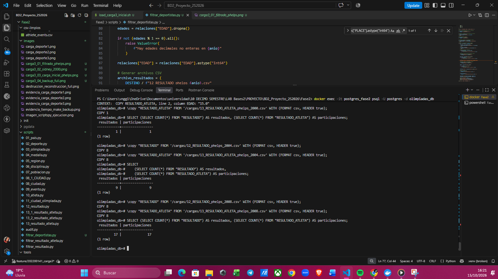

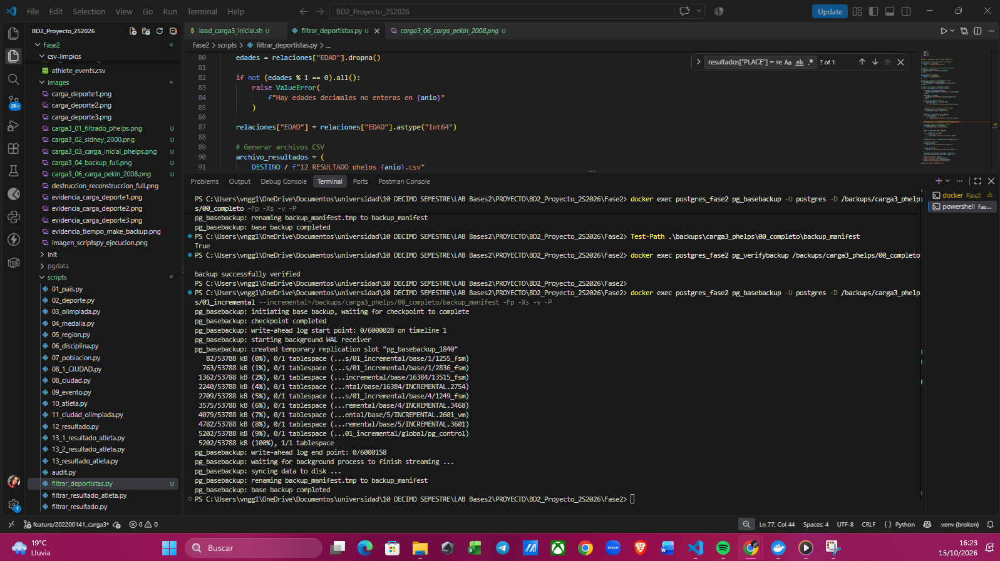

**C. Segunda carga incremental: Londres 2012**

Después de incorporar Londres 2012, se creó el segundo incremental respecto al manifiesto del incremental anterior. Se verificaron **24 resultados y 24 participaciones** acumulados.

```powershell
docker exec postgres_fase2 pg_basebackup -U postgres -D /backups/carga3_phelps/02_incremental --incremental=/backups/carga3_phelps/01_incremental/backup_manifest -Fp -Xs -v -P
```

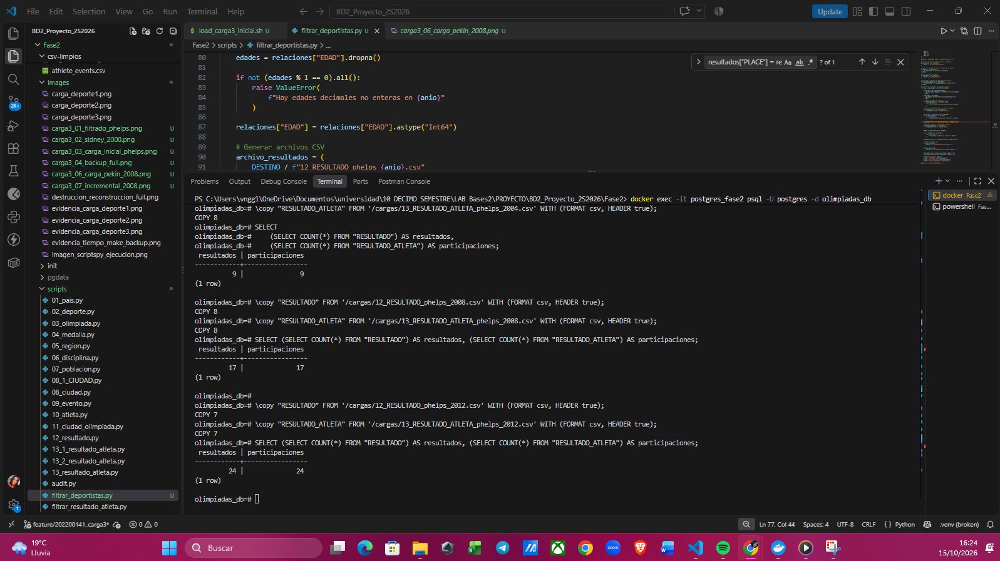

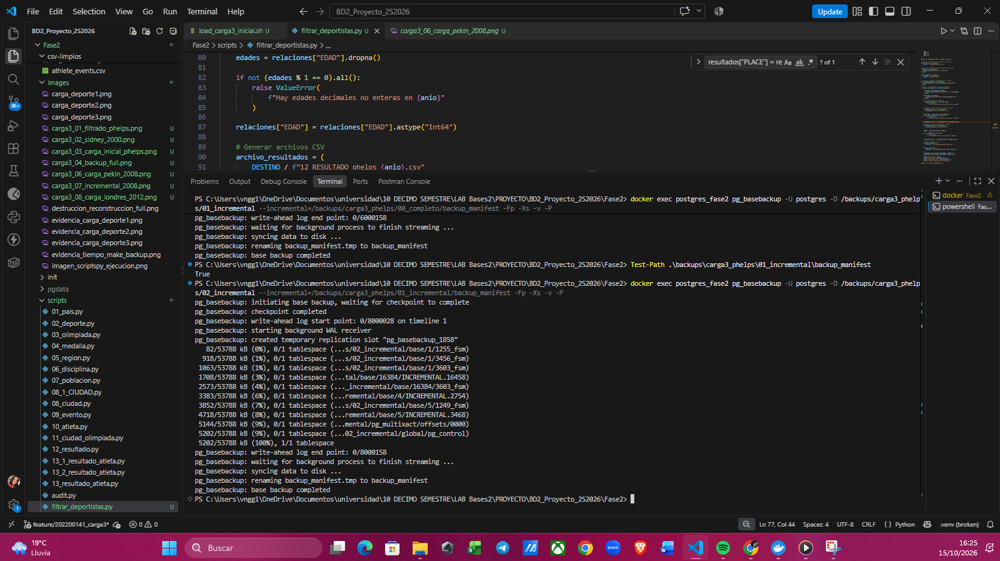

**D. Tercera carga incremental: Río 2016**

Finalmente, se agregaron los registros de Río 2016 y se creó el tercer incremental, referenciado al segundo. El estado final validado fue de **30 resultados y 30 participaciones**.

```powershell
docker exec postgres_fase2 pg_basebackup -U postgres -D /backups/carga3_phelps/03_incremental --incremental=/backups/carga3_phelps/02_incremental/backup_manifest -Fp -Xs -v -P
```

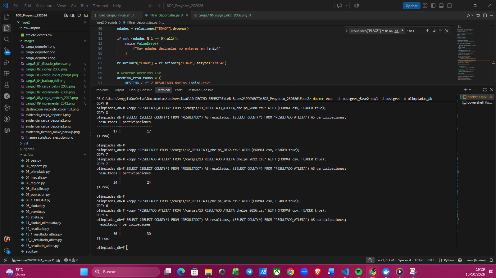

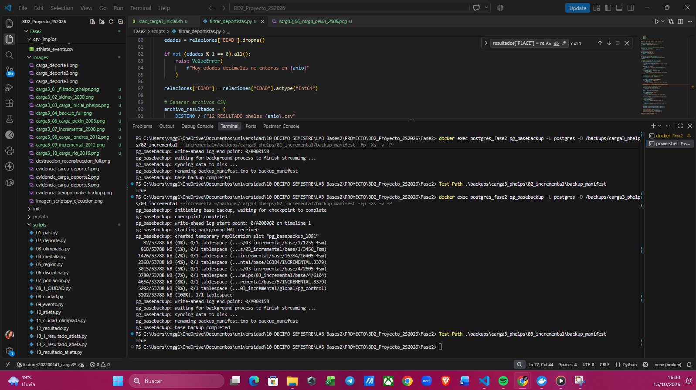

**E. Reconstrucción, restauración y validación**

Para recuperar un estado incremental se necesita el FULL y todos los incrementales intermedios. La reconstrucción física se realizó con `pg_combinebackup`, y la integridad de los respaldos resultantes se comprobó con `pg_verifybackup`.

Por ejemplo, para reconstruir una copia hasta Londres 2012, desde PowerShell y la carpeta `Fase2`:

```powershell
docker run --rm --entrypoint pg_combinebackup `
  -v "${PWD}/backups/carga3_phelps:/backups" `
  fase2-db:latest `
  /backups/00_completo `
  /backups/01_incremental `
  /backups/02_incremental `
  -o /backups/08_demo_2012
```

```powershell
docker run --rm --entrypoint pg_verifybackup `
  -v "${PWD}/backups/carga3_phelps:/backups:ro" `
  fase2-db:latest `
  /backups/08_demo_2012
```

En el simulacro se obtuvo `backup successfully verified`. Posteriormente, se copiaron los archivos reconstruidos a un volumen Docker independiente, se inició PostgreSQL desde ese volumen y se validaron los datos mediante consultas:

```sql
SELECT COUNT(*) FROM "RESULTADO";
SELECT COUNT(*) FROM "RESULTADO_ATLETA";
SELECT * FROM "RESULTADO" LIMIT 10;
SELECT * FROM "RESULTADO_ATLETA" LIMIT 10;
```

El simulacro de Londres 2012 se ejecutó con el contenedor principal `postgres_fase2` detenido, sin eliminar realmente su directorio de datos. Las consultas devolvieron **24 registros en cada tabla**.

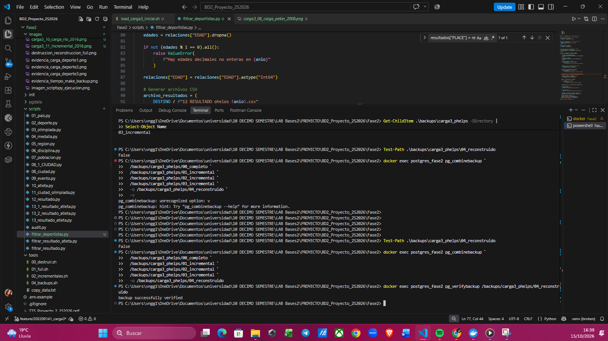

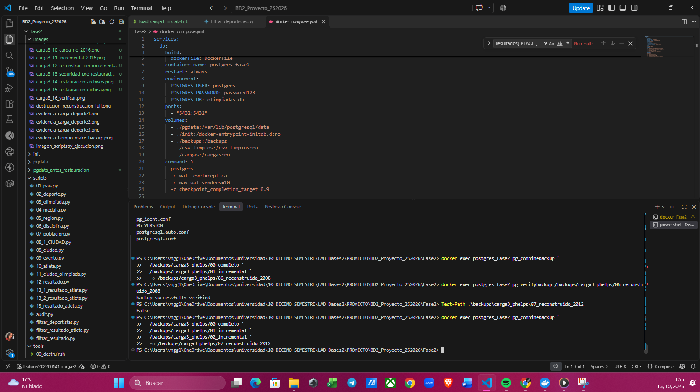

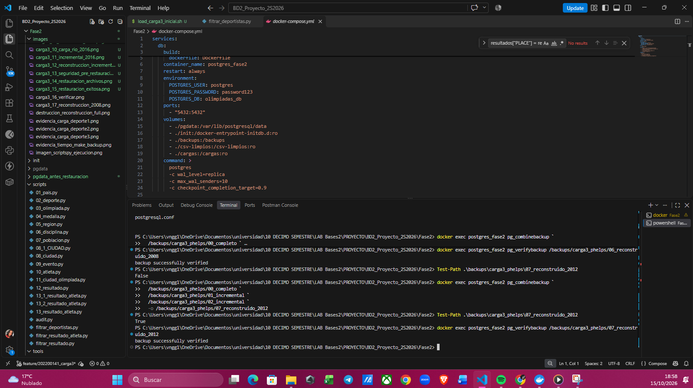

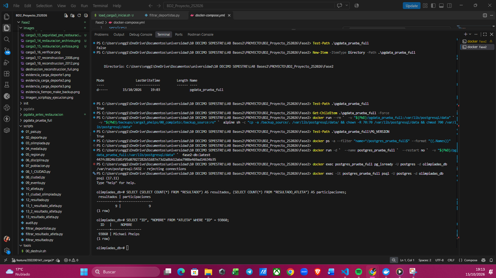

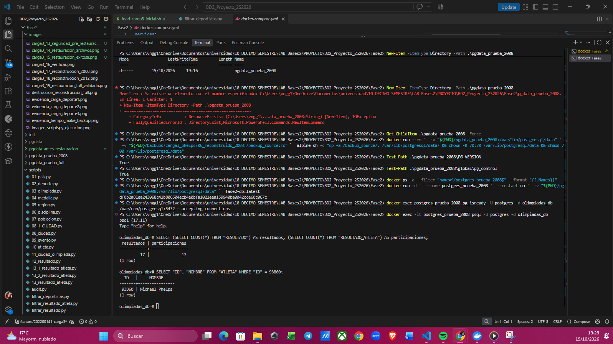

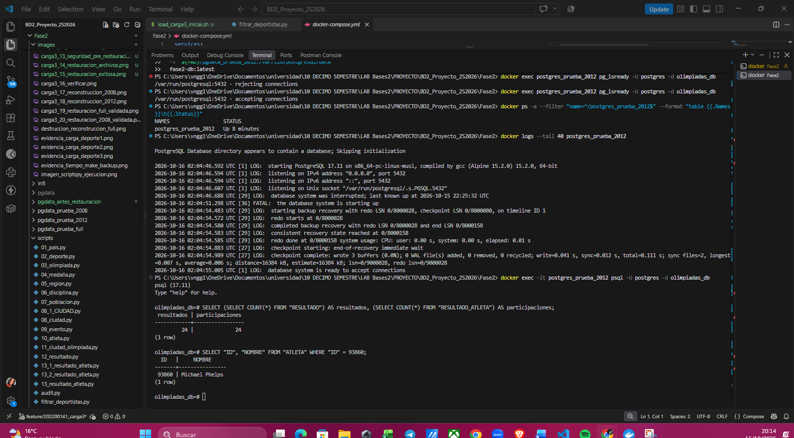

**F. Script de restauración y resultados**

Se implementó `tools/carga3_restaurar.sh` para seleccionar respaldos previamente preparados y restaurarlos en contenedores Docker independientes. Sus opciones son:

```powershell
bash tools/carga3_restaurar.sh full
bash tools/carga3_restaurar.sh 2008
bash tools/carga3_restaurar.sh 2012
bash tools/carga3_restaurar.sh 2016
```

| Estado restaurado | Copia física utilizada por el script | `RESULTADO` | `RESULTADO_ATLETA` |
|---|---|---:|---:|
| Inicial (FULL) | `00_completo` | 9 | 9 |
| Hasta 2008 | `06_reconstruido_2008` | 17 | 17 |
| Hasta 2012 | `07_reconstruido_2012` | 24 | 24 |
| Hasta 2016 | `04_reconstruido` | 30 | 30 |

Las cuatro restauraciones fueron comprobadas mediante los conteos esperados. Este script **no crea el FULL ni los incrementales** y **no reconstruye desde cero**: requiere que las copias indicadas estén disponibles.

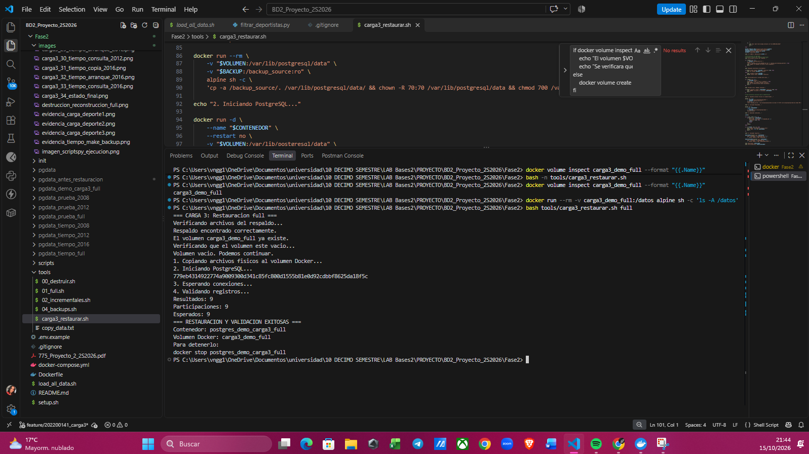

**G. Evidencia de tiempos de recuperación**

Se tomaron capturas de los tiempos correspondientes a copia, arranque y consulta de las diferentes etapas. Los valores exactos deben transcribirse de las capturas originales antes de calcular un tiempo total comparable; **no se asignan valores no verificados**.

| Etapa | Copia | Arranque | Consulta |
|---|---|---|---|
| FULL | [Captura](images/carga3_22_tiempo_copia_full.png) | [Validación](images/carga3_23_validacion_tiempo_full.png) | [Captura](images/carga3_24_tiempo_consulta_full.png) |
| 2008 | [Captura](images/carga3_25_tiempo_copia_2008.png) | [Captura](images/carga3_26_tiempo_arranque_2008.png) | [Captura](images/carga3_27_tiempo_consulta_2008.png) |
| 2012 | [Captura](images/carga3_28_tiempo_copia_2012.png) | [Captura](images/carga3_29_tiempo_arranque_2012.png) | [Captura](images/carga3_30_tiempo_consulta_2012.png) |
| 2016 | [Captura](images/carga3_31_tiempo_copia_2016.png) | [Captura](images/carga3_32_tiempo_arranque_2016.png) | [Captura](images/carga3_33_tiempo_consulta_2016.png) |

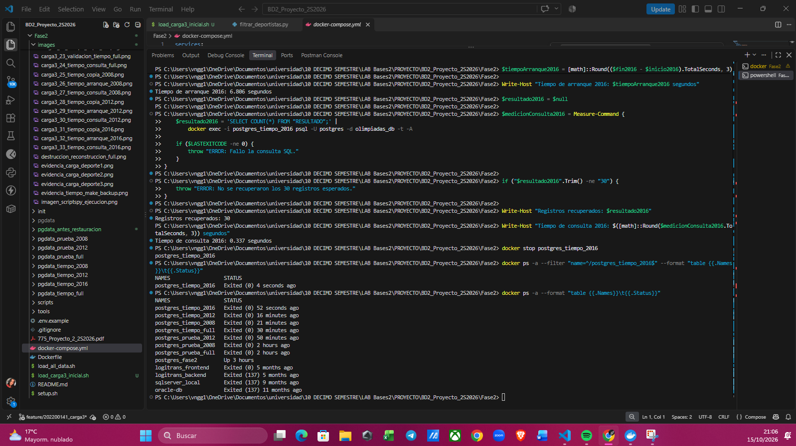

> **Nota para la entrega:** los directorios físicos de backup bajo `backups/carga3_phelps/` se excluyeron de Git. Para repetir las restauraciones en otra computadora es necesario transferir previamente dichos respaldos. Las capturas y los scripts no sustituyen los archivos físicos.


\---


**## 6. Análisis Comparativo de Resultados**


La siguiente tabla expone los tiempos métricos de restauración (RTO - Recovery Time Objective) extraídos al destruir completamente el volumen de datos (\`pgdata\`) y reconstruirlo desde los respaldos físicos generados.


\| Estrategia de Respaldo | Escenario Evaluado | Tiempo de Restauración (RTO) |

\| :--- | :--- | :--- |

\| **\*\*Full Backup\*\*** | Restauración única del catálogo base (Hasta 2012) | **\*\*0.86 segundos\*\*** |

\| **\*\*Full + Incrementales\*\*** | Reconstrucción total encadenando 3 etapas (Hasta 2020) | **\*\*3.73 segundos\*\*** |

\| *\*Full Backup (Carga 2)\** | Deporte: Arqueria | 270 segundo |

\| *\*Full + Inc. (Carga 2)\** | Deportes: Arqueria + golf + handball | 290 Segundos |

\| *\*Full Backup (Carga 3)\** | Michael Phelps: 2000 y 2004 (9 resultados) | *\*Pendiente de transcribir de la evidencia\** |

\| *\*Full + Inc. (Carga 3)\** | Michael Phelps: hasta 2016 (30 resultados) | *\*Pendiente de transcribir de la evidencia\** |


**\*\*Análisis de Rendimiento (Carga 1):\*\***

La recuperación desde un Full Backup es casi inmediata (0.86s) ya que el proceso se limita a copiar la estructura de archivos intacta directamente al directorio persistente de PostgreSQL. La estrategia de restauración incremental tomó 3.73s, un tiempo superior justificado por el procesamiento interno de la utilidad \`pg_combinebackup\`, la cual requiere leer el manifiesto del *\*Full Backup\** y procesar iterativamente los bloques de datos con los archivos WAL (Write-Ahead Logging) generados en 2016 y 2020 antes de iniciar el servicio.


\---


**## 7. Conclusiones**

1\. **\*\*La estrategia incremental es estadísticamente óptima a largo plazo.\*\*** Aunque penaliza ligeramente el tiempo de recuperación (3.73s vs 0.86s en el Escenario 1), reduce drásticamente la carga de I/O en el servidor de producción y el consumo de almacenamiento durante las ventanas de respaldo diarias.

2\. La implementación de herramientas nativas como \`pg_basebackup\` garantiza una consistencia a nivel de bloque, evitando los cuellos de botella característicos de las reconstrucciones lógicas (\`pg_restore\` o inserciones SQL masivas).

3\. Debido a que la carga y backup full tiene toda la informacion y solo simulamos que se crean nuevos resultados entre si, ej: resultados de handball con el fin de buscar un punto en el cual la base de datos tenga informacion "perdida", al momento de hacer el backup se tarda un poco mas que sino tuviera todos los datos faltando solo las relaciones entre si de resultado y resultado-atleta. AL momento de cargar los otros incrementales baja entre cada respaldo el tiempo.

4\. En la Carga 3 por deportista, el FULL inicial permitió recuperar 9 resultados de Michael Phelps, mientras que las reconstrucciones sucesivas hasta 2008, 2012 y 2016 permitieron recuperar 17, 24 y 30 respectivamente. Las restauraciones fueron validadas mediante consultas SQL a las tablas `RESULTADO` y `RESULTADO_ATLETA`. Para concluir sobre eficiencia temporal frente al FULL es necesario transcribir y comparar los tiempos medidos, evitando extrapolar datos de otras cargas.


\---


**## 8. Manual de Usuario (Procedimientos DBA)**


**### 8.1 Ejecución de Respaldos**

Para ejecutar respaldos físicos, el contenedor de base de datos debe estar activo y con el modo de archivado habilitado.

1\. **\*\*Generar Respaldo Completo:\*\***

   \`\`\`bash

   docker exec [nombre_contenedor] pg_basebackup -U postgres -D /ruta/local/full -Fp -Xs -v -P

   \`\`\`

2\. **\*\*Generar Respaldo Incremental:\*\***

   \`\`\`bash

   docker exec [nombre_contenedor] pg_basebackup -U postgres -D /ruta/local/inc1 --incremental=/ruta/local/full/backup_manifest -Fp -Xs -v -P

   \`\`\`


**### 8.2 Proceso de Restauración**

1\. Detenga el servicio y elimine completamente el directorio de datos actual (\`pgdata\`).

2\. Para restaurar **\*\*únicamente un Full Backup\*\***, copie los archivos de la carpeta del respaldo hacia el directorio de datos de PostgreSQL y reinicie el servicio.

3\. Para restaurar una **\*\*cadena incremental\*\***, combine los archivos utilizando \`pg_combinebackup\` en un contenedor temporal:

   \`\`\`bash

   docker run --rm -v [ruta_backups]:/backups -v [ruta_salida]:/restore_combined postgres:17-alpine pg_combinebackup -o /restore_combined /backups/full /backups/inc1 /backups/inc2

   \`\`\`

4\. Copie los archivos combinados resultantes hacia el directorio principal de la base de datos, ajuste los permisos del propietario (\`chown -R 70:70\` para PostgreSQL en Alpine) y levante el servicio mediante Docker Compose.

**### 8.3 Restauración específica de la Carga 3 — Michael Phelps**

Desde `Fase2`, en PowerShell, el script permite restaurar copias físicas **ya preparadas**:

```powershell
bash tools/carga3_restaurar.sh full
bash tools/carga3_restaurar.sh 2008
bash tools/carga3_restaurar.sh 2012
bash tools/carga3_restaurar.sh 2016
```

Estas restauraciones utilizan contenedores y volúmenes independientes de la base principal. Los respaldos físicos deben estar presentes en `backups/carga3_phelps/`. No repetir una etapa sobre un volumen de demostración con datos existentes sin limpieza controlada.

Para demostrar reconstrucción desde los incrementales originales, primero utilizar `pg_combinebackup` con el FULL y toda la cadena correspondiente (ver apartado 5.3 E), verificar el respaldo reconstruido con `pg_verifybackup` y después restaurar esos archivos en PostgreSQL. **Reconstruir no equivale a restaurar.**

Las consultas de validación deben incluir `SELECT *` y `SELECT COUNT(*)`, y el tiempo medido debe definir claramente si comprende la reconstrucción, la copia, el arranque o todo el proceso.
